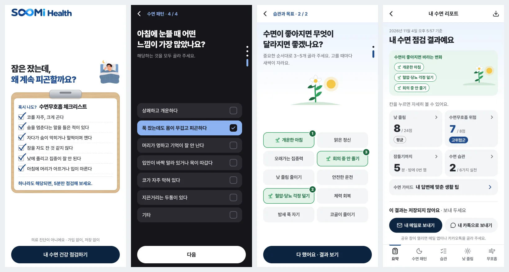

# SOOMi Sleep Check

**SOOMi Sleep Check turns "I snore and I'm always tired, but is it worth mentioning?" into a one-page report you can bring to a clinic, in about five minutes on your phone.** Free. No sign-up, no server, nothing saved.

**Try it:** [sleep-check.soomihealth.care](https://sleep-check.soomihealth.care) (in Korean, best on a phone)

Built at **[SOOMi Health](https://soomihealth.care)** by a non-developer founder working with AI coding agents. This repository is an overview; the source code is private.



> **Not a medical diagnosis.** The results help you reflect on your sleep. If a symptom worries you, talk to a sleep specialist.

**Who this is for:**
- **People who snore or feel tired during the day** — and have never mentioned it to a doctor.
- **Anyone getting ready for a clinic visit** — who wants their sleep put into words before they go.

## What it is for

- **A free first step.** Snoring and daytime tiredness are easy to ignore. This takes about five minutes.
- **Plain words, not test names.** Questionnaire names never appear on screen; each result is explained in everyday language.
- **Private by design.** No login, no name, email or phone number. Answers disappear when the tab closes.
- **A report that goes with you.** Send it to your own KakaoTalk or mail app and show it at the clinic.

## Quick start

1. Open [sleep-check.soomihealth.care](https://sleep-check.soomihealth.care) on your phone.
2. Answer one question per screen. Single-choice answers move on as soon as you tap.
3. Pick the goals you hope will change.
4. Read your report, then send it to yourself.

## See it work

```
You:    Open the link. A pencil ticks off common warning signs on a clipboard.
You:    Tap an answer.
App:    Moves straight to the next question, on a calm dark night screen.
You:    Pick what you hope changes.
App:    A sprout grows with each goal you pick.
App:    Your report: a summary grid, one screen per result in plain words,
        a guide matched to your answers, and a short explainer on the
        overnight sleep test.
You:    Send it to your own KakaoTalk or mail app.
```

## How it flows

**Sleep pattern → Daytime sleepiness → Breathing during sleep → Habits and goals → Report**

22 questions in four short parts, in Korean:

| Part | Questions | What comes back |
|---|---|---|
| Sleep pattern | 4 | Time to fall asleep, night awakenings, how mornings feel |
| Daytime sleepiness | 9 | A daytime sleepiness score from 8 everyday situations (based on the Epworth Sleepiness Scale), plus one question on daytime tiredness that counts toward the breathing signals |
| Breathing during sleep and health | 7 | A count of sleep apnea risk signals (based on STOP-Bang) |
| Habits and goals | 2 | Sleep habits you already keep, and what you hope changes |

## Design choices

- **One question per screen**, answers at thumb height.
- **Night questions, morning bookends.** Questions sit on a calm dark screen; the welcome, goals, and results use a bright morning look.
- **A clipboard that checks itself.** On the welcome screen, a pencil ticks off common warning signs one by one.
- **A sprout that grows** with each goal you pick, and again on the result summary.

## Privacy

- No login. The app never asks for a name, email, or phone number.
- Answers live only in the page's memory and disappear when the tab closes. No cookies, no storage, no analytics.
- Results can be sent to your own KakaoTalk or mail app from the phone. They never pass through SOOMi Health.

## Built with

React · TypeScript · Vite · Tailwind CSS · framer-motion. Static site, no backend.

## Related

SOOMi Health also builds [CareLoop](https://github.com/sylvie-kim/careloop), an operations console for sleep clinics and CPAP providers.

---

Five minutes, plain words, a report you can bring to a clinic. Contact: [soomihealth.care](https://soomihealth.care)
